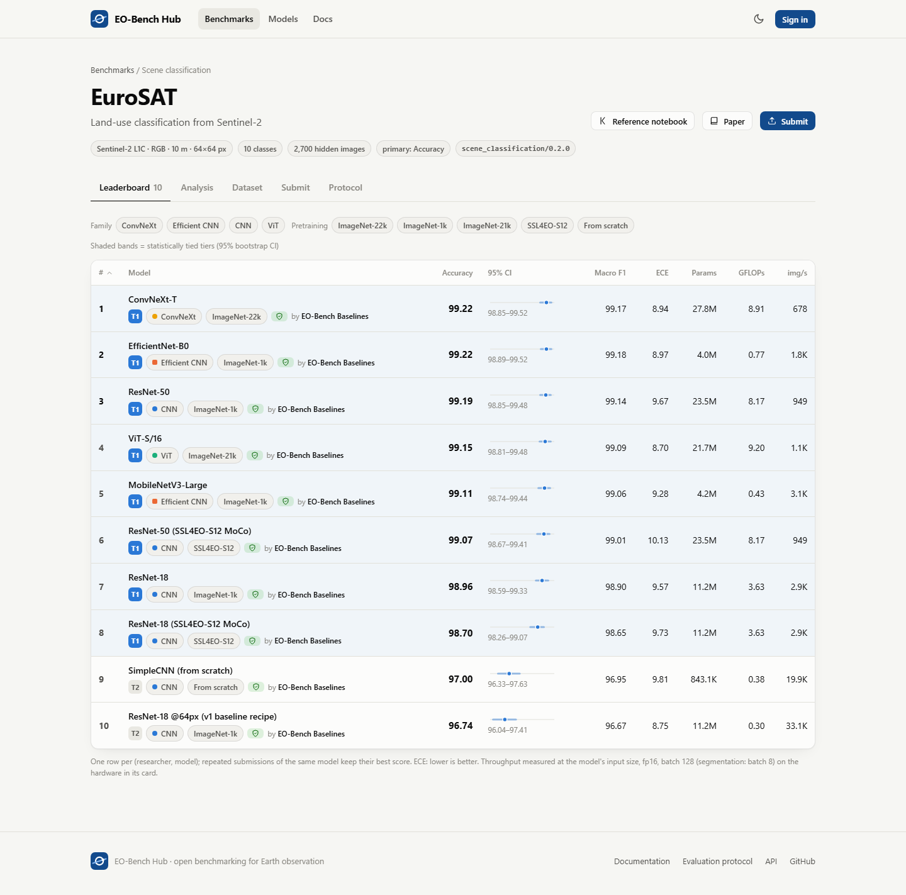
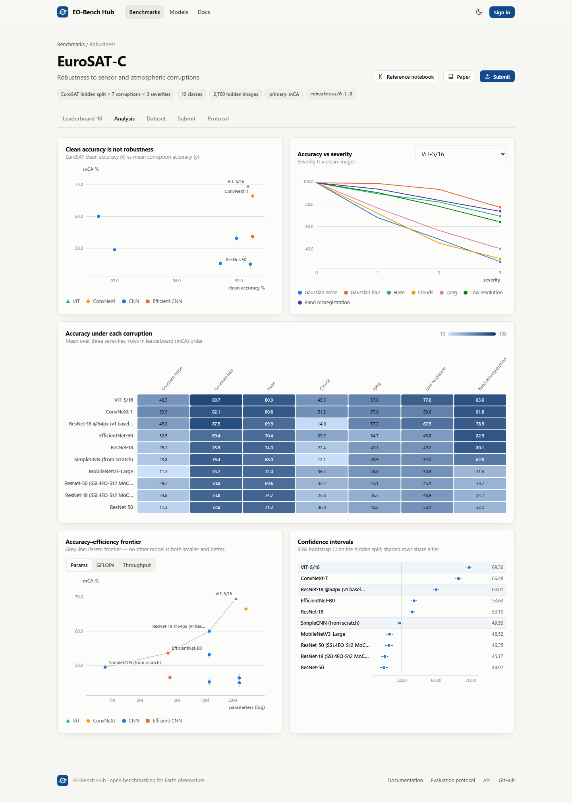
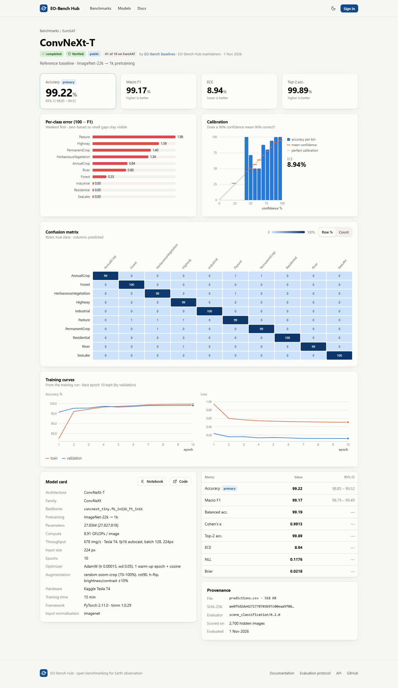
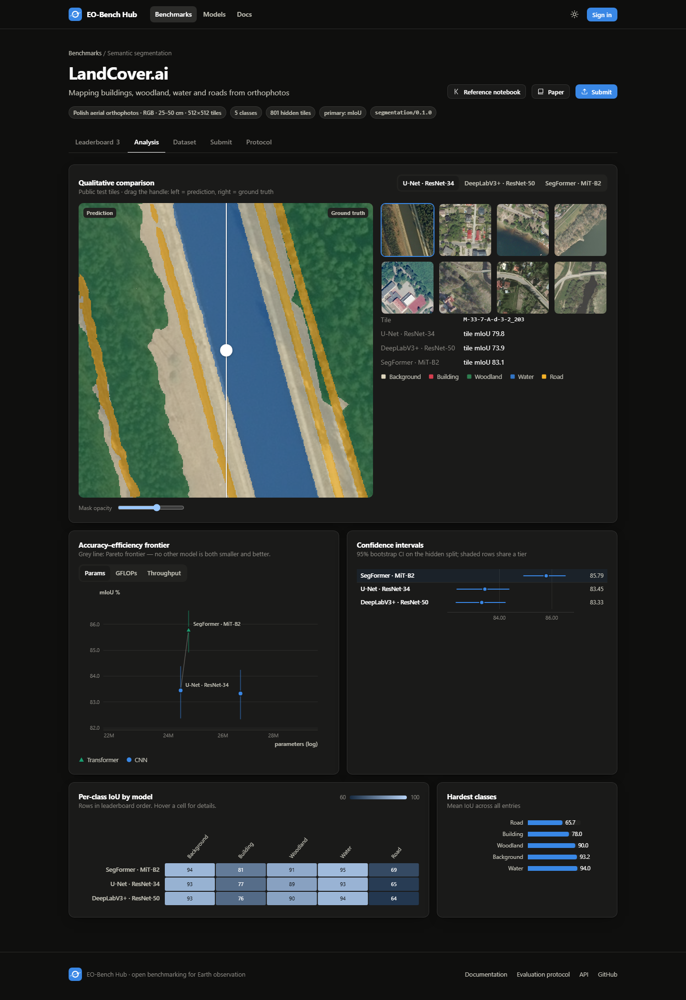
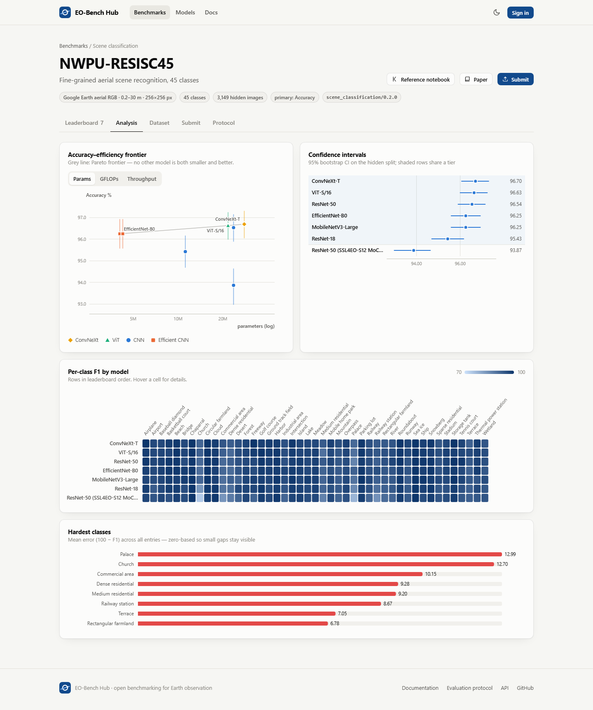

# EO-Bench Hub

[](https://github.com/mohameddddt/eo-benchmark-hub/actions/workflows/ci.yml)
[](https://mohameddddt.github.io/eo-benchmark-hub/)
[](LICENSE)

**Benchmarks for Earth-observation models that tell you more than one number.**

**[Live demo →](https://mohameddddt.github.io/eo-benchmark-hub/)** (read-only snapshot; run it locally to submit models)

Researchers upload predictions and get scored on hidden test splits. Every score
comes with a confidence interval, and the hub also measures robustness under
realistic sensor and atmospheric corruptions, calibration, and the
accuracy-efficiency trade-off. The evaluator code is versioned and identical for
every model.


| | |
|---|---|
|  |  |
|  |  |
|  |  |

## What's inside

| Benchmark | Task | Data | Primary metric |
|---|---|---|---|
| **EuroSAT** | Scene classification, 10 classes | Sentinel-2 RGB, 10 m, 64 px | Accuracy |
| **EuroSAT-C** | Robustness: 7 EO corruptions × 3 severities | EuroSAT hidden split | Mean corruption accuracy |
| **NWPU-RESISC45** | Scene classification, 45 classes | Aerial RGB, 0.2–30 m, 256 px | Accuracy |
| **BigEarthNet-S2** | Multi-label classification, 19 classes | Sentinel-2 RGB, 10 m, 120 px (10% of reBEN) | Macro mAP |
| **LandCover.ai** | Semantic segmentation, 5 classes | Aerial orthophotos, 25–50 cm | mIoU |

## Results from the reference models

Every number below comes from the hub's evaluators on the hidden split. Brackets are 95% bootstrap CIs; **T1** means statistically tied with the leader.

| Benchmark | Leader | Score | Runner-up | Spread across zoo |
|---|---|---|---|---|
| EuroSAT (accuracy) | ConvNeXt-T | **99.22** [98.85, 99.52] | EfficientNet-B0 99.22 (T1) | 8 of 10 models tied in T1 |
| EuroSAT-C (mCA) | ViT-S/16 | **69.56** [68.86, 70.19] | ConvNeXt-T 66.48 | 44.9 – 69.6 |
| NWPU-RESISC45 (accuracy) | ConvNeXt-T | **96.70** [96.06, 97.30] | ViT-S/16 96.63 (T1) | 93.9 – 96.7 |
| BigEarthNet-S2 (macro mAP) | ConvNeXt-T | **75.62** [74.50, 76.81] | ViT-S/16 75.23 (T1) | 72.6 – 75.6 |
| LandCover.ai (mIoU) | SegFormer · MiT-B2 | **85.79** [84.93, 86.52] | U-Net · ResNet-34 83.45 | 83.3 – 85.8 |

What the baselines show:

- **Clean accuracy hides robustness.** The eight ImageNet- and SSL4EO-pretrained EuroSAT models are statistically tied within about half a point. Under EuroSAT-C they spread over 25 points: ViT-S/16 keeps 70% of its accuracy, ResNet-50 keeps 45%. A single pixel of band misregistration drops MobileNetV3 and ResNet-50 to about a third, while ViT and ConvNeXt hold above 80%.
- **Domain pretraining is not free.** SSL4EO-S12 (Sentinel-2 self-supervised) weights are tied with ImageNet on EuroSAT, lose 2.7 points on 0.2–30 m aerial RESISC45, and even on in-domain Sentinel-2 BigEarthNet trail ImageNet ResNet-50 by 2 mAP points after fine-tuning. On EuroSAT their input normalization matters a lot: with ImageNet statistics a frozen-feature kNN reaches 69.6%, with reflectance scaling 92.3%. The kernels choose this with a train/val probe.
- **Label smoothing shows up as miscalibration.** Every classifier trained with smoothing 0.1 has an ECE of about 9%, all under-confident. The reliability diagrams make this visible; accuracy alone hides it.
- **Geographic splits are harder.** On BigEarthNet every model scores about 6 mAP points lower on the official test regions than on validation, a gap a random split would hide. Labels with only a handful of hidden positives are excluded from the macro average (their AP swings from 7 to 42 across near-identical models).
- **Thin structures are the hard part of segmentation.** Roads (64–69 IoU) and buildings (76–81 IoU) separate the models; woodland and water are near-solved.


Training notebooks (public, one per benchmark):
[EuroSAT + EuroSAT-C](https://www.kaggle.com/code/mohameddddt/eobench-eurosat) ·
[RESISC45](https://www.kaggle.com/code/mohameddddt/eobench-resisc45) ·
[BigEarthNet](https://www.kaggle.com/code/mohameddddt/eobench-bigearthnet) ·
[LandCover.ai](https://www.kaggle.com/code/mohameddddt/eobench-landcoverai)

Each benchmark ships with a **model zoo trained on Kaggle T4 GPUs** using one
documented recipe per benchmark ([`training/`](training)). The zoo includes
ImageNet versus SSL4EO-S12 (Sentinel-2 self-supervised) pretraining comparisons.
Baselines are scored through the same upload → validate → evaluate path as any
user's file, so no number on the site is hand-entered.

### What the evaluator guarantees

- **No leaky ids.** v1 used filenames (`AnnualCrop_1`), so reading the label off the id scored 100% ([ASSESSMENT.md](ASSESSMENT.md)). v2 ids are content hashes.
- **Rankings with error bars.** Every primary metric has a seeded 95% bootstrap CI. Entries whose intervals overlap the tier leader's share a tier.
- **Robustness, calibration and cost.** EuroSAT-C, ECE/NLL/Brier with reliability diagrams, and parameters, GFLOPs and measured throughput on a Pareto frontier.
- **Reproducible splits.** The same `eobench_eval.splits` code runs on Kaggle, in `scripts/make_splits.py`, and on the server, and the split fingerprint is shown on every benchmark page.

## Quickstart

You only need Python 3.11+ and Node 20+. No Docker, database server or broker is required.

```bash
python -m venv .venv && . .venv/bin/activate      # Windows: .venv\Scripts\activate
pip install -r backend/requirements-dev.txt -e evaluation
cd frontend && npm install && npm run build && cd ..

python scripts/seed.py                             # register benchmarks, score installed baselines
uvicorn app.main:app --app-dir backend --port 8000 # → http://localhost:8000  (API docs: /api/docs)
```

For frontend development, run `make api` and `make web` (Vite on :5173 proxies `/api`).

### Getting the ground truth and baselines

Hidden labels are never committed. Rebuild them from the Kaggle kernels:

```bash
python training/kaggle.py push eurosat      # trains the zoo on a Kaggle T4 (private kernel)
python training/kaggle.py pull eurosat      # → data/kaggle/eurosat/
python scripts/import_kaggle.py eurosat     # installs ground truth, baselines, website media
python scripts/seed.py                      # scores the baselines
```

Repeat for `resisc45`, `bigearthnet` and `landcoverai`. Each kernel embeds the repo's own
`eobench_eval` + `eobench_train` packages, so it always runs the code of the
commit it was pushed from.

### Static showcase

```bash
python scripts/export_static.py             # snapshots every public API response
cd frontend && npm run build:static         # read-only site, no backend needed
```

`.github/workflows/pages.yml` deploys this to GitHub Pages. To turn it on, go to Settings → Pages → Source and choose GitHub Actions.

### Multi-user deployment

`docker compose up --build` runs the same app with Postgres, Redis and Celery
workers (`EVAL_BACKEND=celery`). Copy `.env.example` to `.env` first.

## Submitting a model

1. Train on `train`, select on `val`, sanity-check on `test_public`. The public manifest is on each benchmark's Dataset tab.
2. Predict every `test_hidden` id:
   - classification: CSV `sample_id,predicted_label[,prob_<class>…]`
   - EuroSAT-C: the same CSV, plus `<id>@<corruption>-<severity>` rows
   - LandCover.ai: a ZIP of `<tile>.png` class-index masks
3. Upload on the website, or submit with an API token:
   ```bash
   curl -X POST $HUB/api/benchmarks/eurosat/submissions \
     -H "Authorization: Bearer $EOB_TOKEN" -F file=@predictions.csv -F model_name="My model"
   ```
   or with the bundled client, which first validates locally against the public manifest:
   ```bash
   eobench validate predictions.csv --benchmark eurosat --hub $HUB
   EOB_TOKEN=eob_… eobench submit predictions.csv --benchmark eurosat --name "My model" --hub $HUB
   ```
4. Results are private until you add a model card and publish.

## Repository layout

```
backend/      FastAPI app: auth, submissions, CI-aware leaderboards, stats; serves the built SPA
evaluation/   eobench-eval: evaluators (classification, robustness, segmentation, multi-label),
              splits, EuroSAT-C corruptions, bootstrap statistics, plus their tests
training/     Kaggle training package + kernel builder (kaggle.py)
frontend/     React + TypeScript + TanStack Query; hand-built SVG charts; static mode
scripts/      seed, import_kaggle, export_static, make_splits, screenshots
worker/       Celery entry point (optional backend)
data/         ground truth, uploads, baselines — gitignored
```

## Development

```bash
make test     # 47 tests: evaluators, splits, corruptions, bootstrap maths, full API flow
make lint     # ruff
cd frontend && npm run typecheck
```

The v1 EuroSAT golden file must keep scoring exactly 0.975926 accuracy and
0.974783 macro F1. That test runs automatically when the files are present in
`evaluation/tests/golden/`.

## Roadmap

- Seed-variance runs for baselines, so CIs can cover training noise as well as test-set noise.

## License and data

Code is released under the [MIT License](LICENSE). The datasets keep their own
licences and are never redistributed — only small thumbnails, public split
manifests (ids and splits, no labels) and aggregate scores are included:
EuroSAT (MIT), NWPU-RESISC45 (research use), BigEarthNet (CDLA-Permissive-1.0),
LandCover.ai (CC BY-NC-SA 4.0).
Please cite the original dataset papers listed on each benchmark page.

